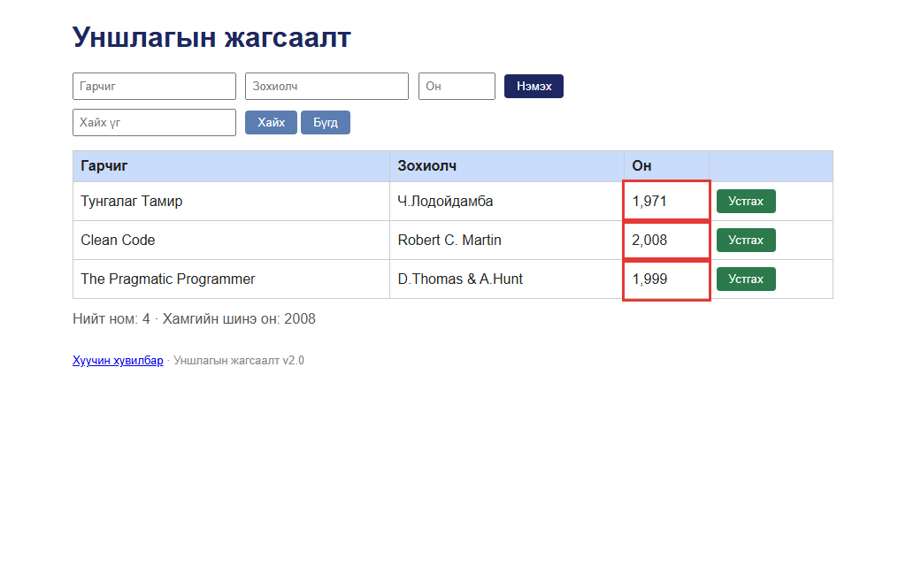

# BUG-01: Номын хүснэгтийн «Он» баганад он мянгатын таслалтай (1,971) харагддаг

**Орчин:** Уншлагын жагсаалт v2.0, Microsoft Edge 158.0.4370.33, Windows 11 Pro, 2026-11-25
**Урьдчилсан нөхцөл:** `node app.js`-ийг шинээр асаасан (анхны 3 ном)

## Дахин гаргах алхам

1. Браузераар http://localhost:3000 нээнэ.
2. Номын хүснэгтийн «Он» баганыг харна.

**Хүлээгдэж байсан:** «Он нь 1000-2100 хоорондох бүхэл тоо; хүснэгтэд энгийн тоогоор (жишээ нь 1999) харагдана» — `1971`, `2008`, `1999`.
**Бодит үр дүн:** «Он» баганад `1,971`, `2,008`, `1,999` гэж мянгатын таслалтайгаар (мөнгөн дүн мэт) харагдана. Шинээр нэмсэн номын он ч мөн адил (жишээ нь 2000 → `2,000`).

**Ноцтой байдал:** Minor — өгөгдөл зөв хадгалагдсан (API `"year":1971` буцаана), зөвхөн дэлгэцийн формат буруу ч хэрэглэгч бүрт, мөр бүрт харагдаж спецификацийн шууд зөрчил болно.
**Хавсралт:** 
**Олдсон аялал:** Supermodel
