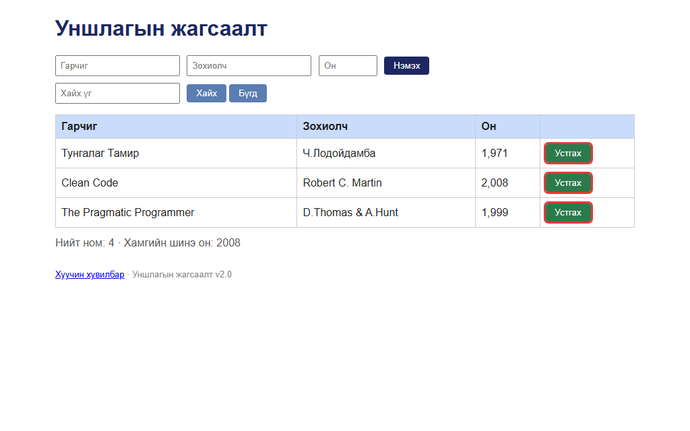

# BUG-02: «Устгах» товч улаан биш, ногоон өнгөтэй

**Орчин:** Уншлагын жагсаалт v2.0, Microsoft Edge 158.0.4370.33, Windows 11 Pro, 2026-11-25
**Урьдчилсан нөхцөл:** `node app.js`-ийг шинээр асаасан (анхны 3 ном)

## Дахин гаргах алхам

1. Браузераар http://localhost:3000 нээнэ.
2. Хүснэгтийн мөр бүрийн баруун талын «Устгах» товчны өнгийг харна (DevTools → Computed → `background-color`).

**Хүлээгдэж байсан:** «Аюултай үйлдлийн товч (Устгах) улаан өнгөтэй».
**Бодит үр дүн:** «Устгах» товч ногоон (`background-color: rgb(44, 122, 75)`) — ихэвчлэн «зөвшөөрөх/амжилттай» гэсэн утгатай өнгө тул хэрэглэгч санамсаргүй дарж ном устгах эрсдэлтэй.

**Ноцтой байдал:** Minor — функц ажиллана, гэхдээ аюултай үйлдлийг буруу дохиолж хэрэглэгчийг төөрөгдүүлнэ (устгал нь буцаагдахгүй).
**Хавсралт:** 
**Олдсон аялал:** Supermodel
