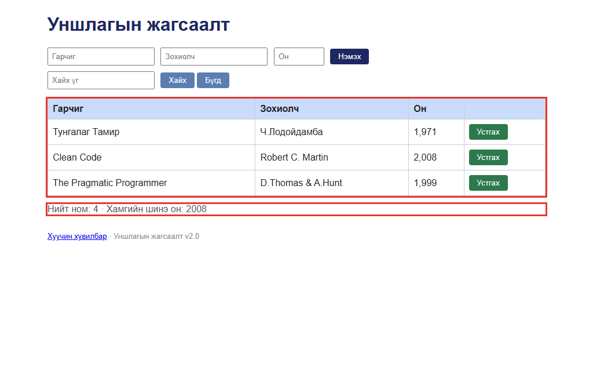

# BUG-03: «Нийт ном» тоолуур (ба `/api/stats` total) бодит номын тооноос 1-ээр их

**Орчин:** Уншлагын жагсаалт v2.0, Microsoft Edge 158.0.4370.33, Windows 11 Pro, `curl` (Git Bash), 2026-11-25
**Урьдчилсан нөхцөл:** `node app.js`-ийг шинээр асаасан (анхны 3 ном)

## Дахин гаргах алхам

1. Браузераар http://localhost:3000 нээнэ.
2. Хүснэгтийн мөрийг тоолно (3 ном) ба хүснэгтийн доорх «Нийт ном: …» текстийг харна.
3. (API) `curl -s -i localhost:3000/api/books` — 3 ном буцаана.
4. (API) `curl -s -i localhost:3000/api/stats` ажиллуулна.
5. (Нэмэлт) «Устгах»-аар нэг ном устгах эсвэл ном нэмсний дараа тоолуурыг дахин харна.

**Хүлээгдэж байсан:** «"Нийт ном" тоолуур хүснэгтэд буй номын тоотой тэнцүү» — `Нийт ном: 3`, `{"total":3,...}`.
**Бодит үр дүн:** Хүснэгтэд 3 ном байхад `Нийт ном: 4`, `/api/stats` → `{"total":4,"newest":2008}`. Ном нэмэх, устгах бүрд зөрүү 1 хэвээр (2 ном үлдэхэд «Нийт ном: 3» — [BUG-10](bug-10.md)-ын зургийг үз).

**Ноцтой байдал:** Major — серверийн тооцооллын (өгөгдлийн түвшний) алдаа тул тоолуурт тулгуурласан бүх дэлгэц, тайлан буруу мэдээлэл харуулна.
**Хавсралт:**  · [evidence/bug-03-curl.txt](../evidence/bug-03-curl.txt)
**Олдсон аялал:** Guidebook (API-гаар эхэлж шалгахад), Supermodel-оор UI-д баталгаажсан
