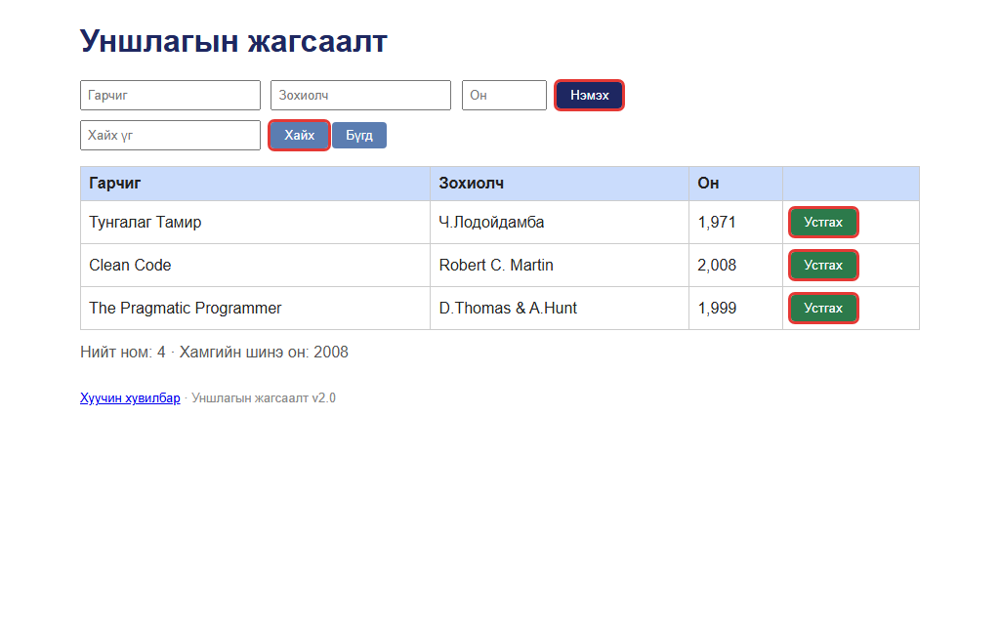

# BUG-04: «Нэмэх» товчны текст латин «x» үсэгтэй («Нэмэx») — үсгийн алдаа

**Орчин:** Уншлагын жагсаалт v2.0, Microsoft Edge 158.0.4370.33, Windows 11 Pro, 2026-11-25
**Урьдчилсан нөхцөл:** `node app.js`-ийг шинээр асаасан (анхны 3 ном)

## Дахин гаргах алхам

1. Браузераар http://localhost:3000 нээнэ.
2. F12 → Console-д дараахыг ажиллуулна:
   `[...document.querySelector('button').textContent].map(c => c.codePointAt(0).toString(16))`
3. (Эсвэл) Ctrl+F-ээр кирилл «Нэмэх» гэж хайна — товч олдохгүй.

**Хүлээгдэж байсан:** «Текстүүд үсгийн алдаагүй» — товч «Нэмэх» (сүүлийн үсэг кирилл `х`, U+0445).
**Бодит үр дүн:** Codepoint-ууд `41d, 44d, 43c, 44d, 78` — сүүлийн үсэг нь латин `x` (U+0078). Нүдэнд ижил харагдах ч хуудсаас «Нэмэх» гэж хайхад олдохгүй, дэлгэц уншигч буруу дуудаж, автомат тест (`getByRole('button', {name: 'Нэмэх'})`) товчийг олохгүй.

**Ноцтой байдал:** Cosmetic — функцэд нөлөөгүй, гэхдээ хайлт, хүртээмж (accessibility), автомат тестэд саад болно.
**Хавсралт:** 
**Олдсон аялал:** Supermodel
