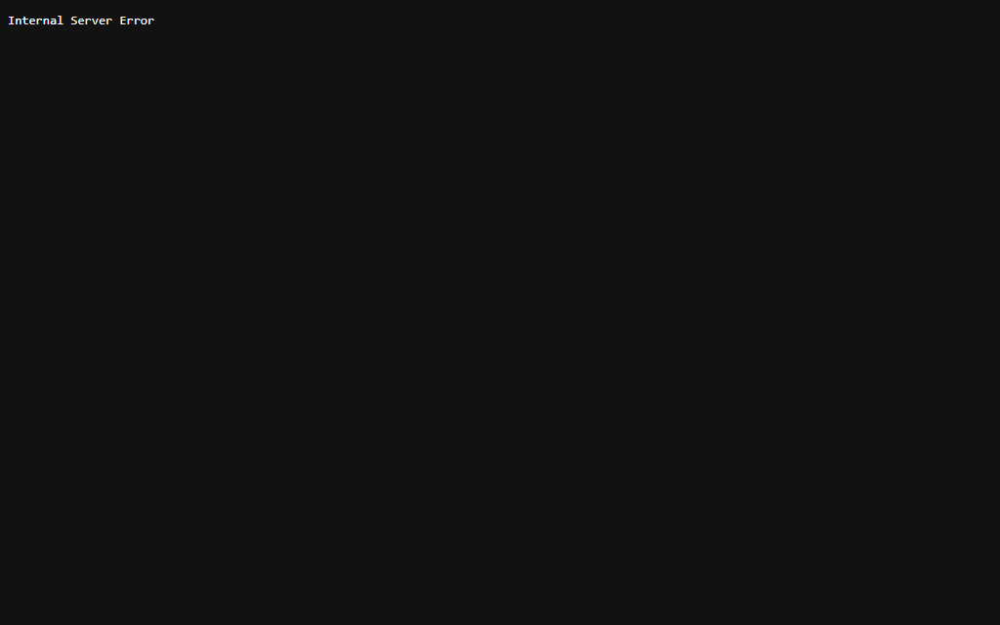

# BUG-05: Footer-ийн «Хуучин хувилбар» линк (`/old`) 500 Internal Server Error буцаадаг

**Орчин:** Уншлагын жагсаалт v2.0, Microsoft Edge 158.0.4370.33, Windows 11 Pro, `curl` (Git Bash), 2026-11-25
**Урьдчилсан нөхцөл:** `node app.js`-ийг шинээр асаасан (анхны 3 ном)

## Дахин гаргах алхам

1. Браузераар http://localhost:3000 нээнэ.
2. Хуудасны доод талын «Хуучин хувилбар» линк дээр дарна.
3. (API) `curl -s -i localhost:3000/old`

**Хүлээгдэж байсан:** «Бүх хуудас, линк ажиллана» — хуучин хувилбарын хуудас (200) нээгдэх эсвэл линк байхгүй байх.
**Бодит үр дүн:** Цагаан текст «Internal Server Error» бүхий хоосон хуудас; `HTTP/1.1 500 Internal Server Error`.

**Ноцтой байдал:** Major — хэрэглэгчид харагдаж буй линк серверийн алдаа (500) өгдөг нь серверт баригдаагүй exception байгааг илтгэнэ; навигаци эвдэрсэн.
**Хавсралт:**  · [evidence/bug-05-curl.txt](../evidence/bug-05-curl.txt)
**Олдсон аялал:** Supermodel (линкийг анзаарсан) → Guidebook («бүх линк ажиллана» дүрмээр шалгасан)
