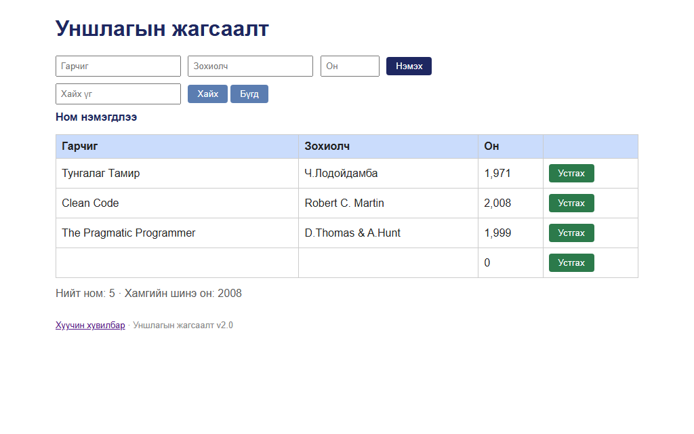

# BUG-06: Гарчиг, Зохиолч, Он хоосон (эсвэл зөвхөн зайтай) байхад ном нэмэгдэж, «Ном нэмэгдлээ» гэж гардаг

**Орчин:** Уншлагын жагсаалт v2.0, Microsoft Edge 158.0.4370.33, Windows 11 Pro, `curl` (Git Bash), 2026-11-25
**Урьдчилсан нөхцөл:** `node app.js`-ийг шинээр асаасан (анхны 3 ном)

## Дахин гаргах алхам

1. Браузераар http://localhost:3000 нээнэ.
2. «Гарчиг», «Зохиолч», «Он» талбаруудыг ХООСОН орхино.
3. «Нэмэх» товч дээр дарна.
4. (API) `curl -s -i -X POST localhost:3000/api/books -H 'Content-Type: application/json' -d '{}'`
5. (API) `curl -s -i -X POST localhost:3000/api/books -H 'Content-Type: application/json' -d '{"title":"   ","author":"   ","year":"2000"}'`

**Хүлээгдэж байсан:** «Гарчиг, Зохиолч, Он гурван талбар бүгд заавал бөглөгдсөн байх ёстой; дутуу бол ном нэмэгдэхгүй, ойлгомжтой алдааны мессеж харагдана.» API-д 400.
**Бодит үр дүн:** Алхам 3: «Ном нэмэгдлээ» мессеж, хүснэгтэд гарчиг/зохиолч хоосон, он `0` бүхий 4 дэх мөр нэмэгдэнэ («Нийт ном: 5»). Алхам 4, 5: `HTTP/1.1 201 Created {"result":"OK","id":4}` / `id":5` — хоосон ба зөвхөн зайтай талбартай номууд хадгалагдана.

**Ноцтой байдал:** Major — заавал талбарын баталгаажуулалт UI ба API аль алинд байхгүй тул утгагүй өгөгдөл хадгалагдаж, хүснэгт, хайлт, тоолуурыг бохирдуулна.
**Хавсралт:**  · [evidence/bug-06-curl.txt](../evidence/bug-06-curl.txt)
**Олдсон аялал:** Couch Potato (UI), Saboteur (API)
