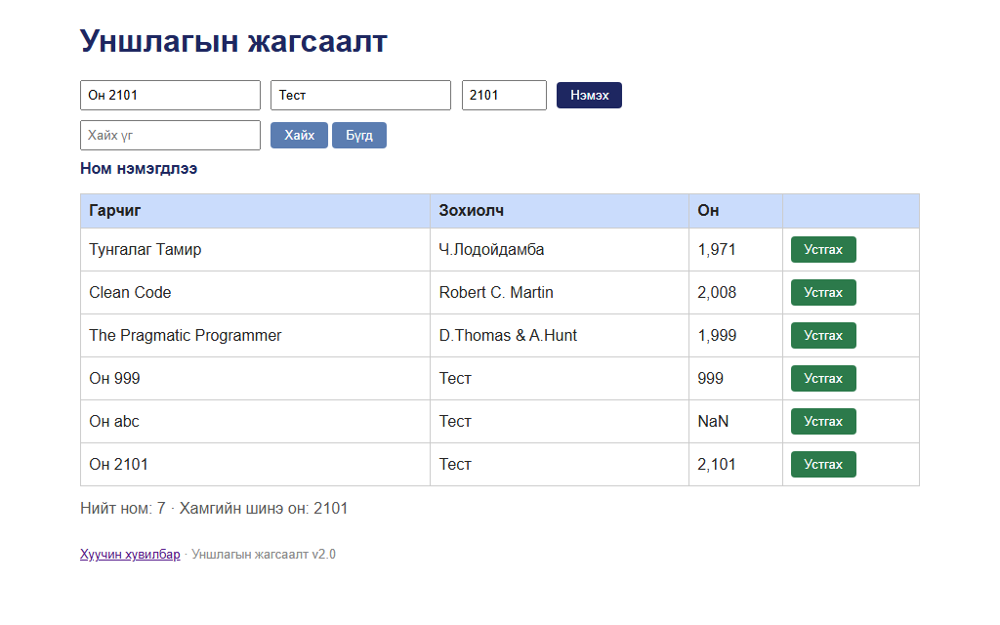

# BUG-07: «Он» талбар 1000-2100 хүрээ ба бүхэл тоо эсэхийг шалгадаггүй (999, 2101, «abc» → NaN, 1999.5 хүлээн авна)

**Орчин:** Уншлагын жагсаалт v2.0, Microsoft Edge 158.0.4370.33, Windows 11 Pro, `curl` (Git Bash), 2026-11-25
**Урьдчилсан нөхцөл:** `node app.js`-ийг шинээр асаасан (анхны 3 ном)

## Дахин гаргах алхам

1. Браузераар http://localhost:3000 нээнэ.
2. Гарчиг `Он 999`, Зохиолч `Тест`, Он `999` гэж бичээд «Нэмэх» дарна.
3. Гарчиг `Он abc`, Зохиолч `Тест`, Он `abc` гэж бичээд «Нэмэх» дарна.
4. Гарчиг `Он 2101`, Зохиолч `Тест`, Он `2101` гэж бичээд «Нэмэх» дарна.
5. Хүснэгт ба «Хамгийн шинэ он»-ыг харна.
6. (API) `curl -s -i -X POST localhost:3000/api/books -H 'Content-Type: application/json' -d '{"title":"Он 1999.5","author":"Тест","year":"1999.5"}'`

**Хүлээгдэж байсан:** «Он нь 1000-2100 хоорондох бүхэл тоо» — алхам 2, 3, 4, 6-д ном нэмэгдэхгүй, ойлгомжтой алдааны мессеж (API-д 400).
**Бодит үр дүн:** Бүгд «Ном нэмэгдлээ»; хүснэгтэд `999`, `NaN`, `2,101` мөрүүд нэмэгдэж, «Хамгийн шинэ он: 2101» болно. API бүгдэд `HTTP/1.1 201 Created` буцааж, онг тоо биш текстээр (`"year":"999"`, `"year":"abc"`) хадгална.

**Ноцтой байдал:** Major — хүрээ, төрлийн баталгаажуулалт байхгүй тул буруу өгөгдөл хадгалагдаж, «Хамгийн шинэ он» статистик буруу болно, хүснэгтэд `NaN` харагдана.
**Хавсралт:**  · [evidence/bug-07-curl.txt](../evidence/bug-07-curl.txt)
**Олдсон аялал:** Guidebook (хилийн утгууд)
