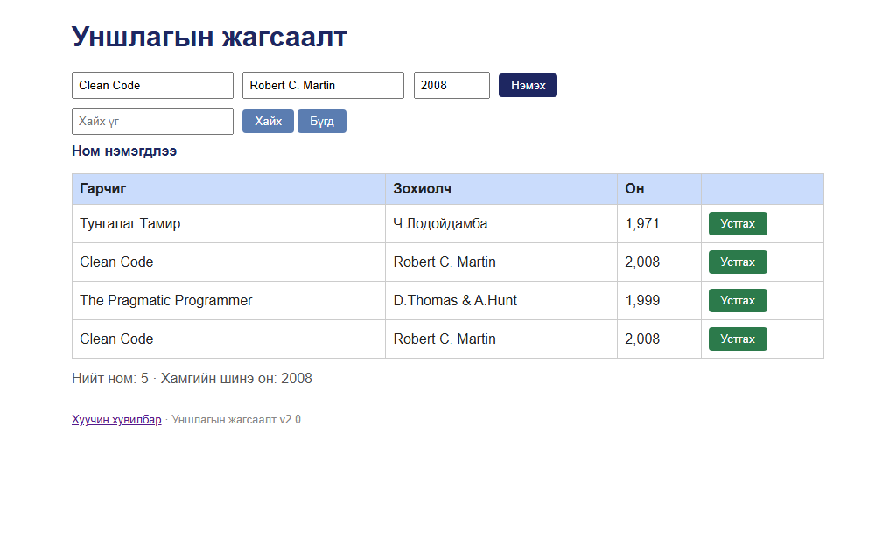

# BUG-08: Ижил гарчиг, зохиолчтой ном давхардан нэмэгддэг

**Орчин:** Уншлагын жагсаалт v2.0, Microsoft Edge 158.0.4370.33, Windows 11 Pro, 2026-11-25
**Урьдчилсан нөхцөл:** `node app.js`-ийг шинээр асаасан (анхны 3 ном, дотор нь «Clean Code» — «Robert C. Martin» — 2008)

## Дахин гаргах алхам

1. Браузераар http://localhost:3000 нээнэ.
2. Гарчиг `Clean Code`, Зохиолч `Robert C. Martin`, Он `2008` гэж бичнэ.
3. «Нэмэх» товч дээр дарна.

**Хүлээгдэж байсан:** «Ижил гарчиг, зохиолчтой ном давхардуулж нэмэгдэхгүй» — ном нэмэгдэхгүй, «ийм ном аль хэдийн байна» гэх мэт мессеж.
**Бодит үр дүн:** «Ном нэмэгдлээ» мессеж гарч, хүснэгтэд «Clean Code — Robert C. Martin — 2,008» хоёр мөр болж, «Нийт ном: 5» болно.

**Ноцтой байдал:** Major — бизнесийн дүрэм (давхардлын хориг) огт хэрэгжээгүй; жагсаалт давхардсан өгөгдлөөр дүүрнэ.
**Хавсралт:** 
**Олдсон аялал:** Obsessive-Compulsive
