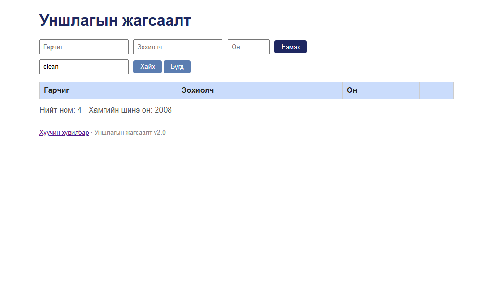

# BUG-09: Хайлт том/жижиг үсэг ялгадаг — «clean» хайхад «Clean Code» олдохгүй

**Орчин:** Уншлагын жагсаалт v2.0, Microsoft Edge 158.0.4370.33, Windows 11 Pro, `curl` (Git Bash), 2026-11-25
**Урьдчилсан нөхцөл:** `node app.js`-ийг шинээр асаасан (анхны 3 ном)

## Дахин гаргах алхам

1. Браузераар http://localhost:3000 нээнэ.
2. «Хайх үг» талбарт `Clean` гэж бичээд «Хайх» дарна → 1 ном («Clean Code») гарна.
3. «Хайх үг» талбарт `clean` (жижиг үсгээр) гэж бичээд «Хайх» дарна.
4. (API) `curl -s -i "localhost:3000/api/books?q=clean"` ба `curl -s -i "localhost:3000/api/books?q=martin"`

**Хүлээгдэж байсан:** «Хайлт гарчиг болон зохиолчоос хайх ба том/жижиг үсэг ЯЛГАХГҮЙ» — `clean` → «Clean Code», `martin` → «Robert C. Martin»-ий ном.
**Бодит үр дүн:** Алхам 3: хүснэгт хоосон (0 ном). API: `?q=Clean` → 1 ном, `?q=clean` → `[]`; `?q=Martin` → 1 ном, `?q=martin` → `[]`. Кирилл үсэгт ч адил: `тунгалаг` → `[]`, `Тунгалаг` → 1 ном.

**Ноцтой байдал:** Major — хэрэглэгчид ихэвчлэн жижиг үсгээр хайдаг тул байгаа номыг «байхгүй» гэж харуулна; спецификацийн шууд зөрчил.
**Хавсралт:**  · [evidence/bug-09-curl.txt](../evidence/bug-09-curl.txt)
**Олдсон аялал:** Guidebook
