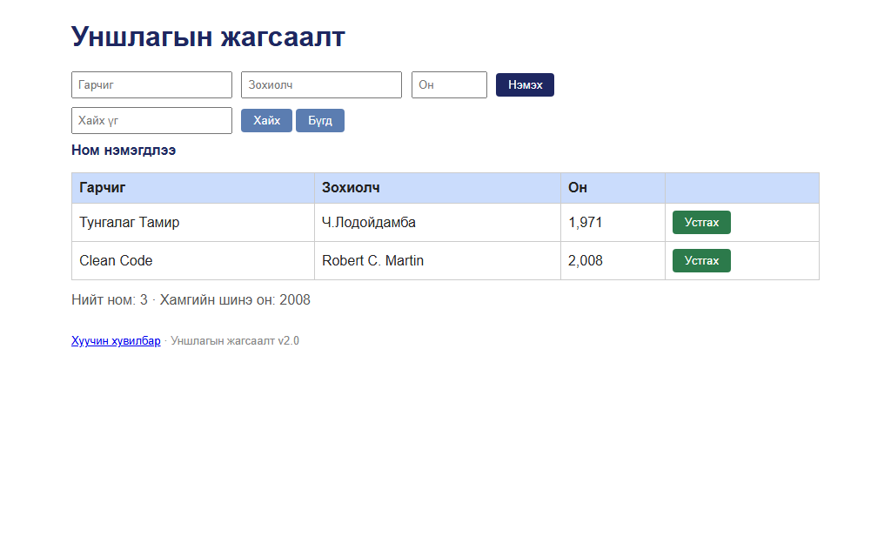

# BUG-10: Ном устгахад «Ном нэмэгдлээ» гэсэн буруу мессеж гардаг

**Орчин:** Уншлагын жагсаалт v2.0, Microsoft Edge 158.0.4370.33, Windows 11 Pro, 2026-11-25
**Урьдчилсан нөхцөл:** `node app.js`-ийг шинээр асаасан (анхны 3 ном)

## Дахин гаргах алхам

1. Браузераар http://localhost:3000 нээнэ (хайлтын доор мессеж байхгүй).
2. «The Pragmatic Programmer» мөрийн «Устгах» товч дээр дарна.

**Хүлээгдэж байсан:** «Үйлдэл бүрийн дараах мессеж тухайн үйлдэлдээ тохирно» — «Ном устгагдлаа» гэх мэт.
**Бодит үр дүн:** Ном устгагдана (2 мөр үлдэнэ), гэхдээ «Ном нэмэгдлээ» гэж нэмэх үйлдлийн мессеж гарна. (Мөн «Нийт ном: 3» — [BUG-03](bug-03.md).)

**Ноцтой байдал:** Minor — үйлдэл зөв хийгдэнэ, гэхдээ хэрэглэгч ном нэмэгдсэн гэж ойлгож төөрөгдөнө.
**Хавсралт:** 
**Олдсон аялал:** Guidebook (санамсаргүй — эхэндээ хуучин мессеж үлдсэн гэж бодоод reload хийж баталгаажуулсан)
