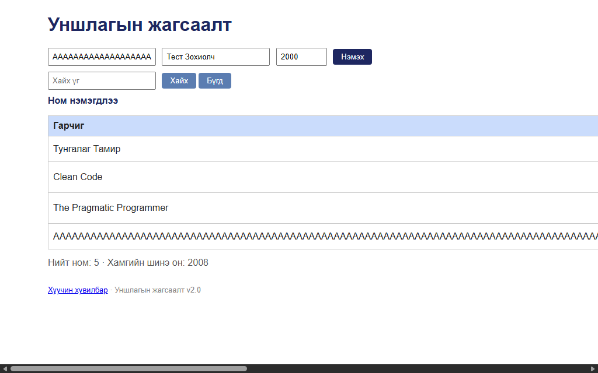

# BUG-11: Урт (зайгүй) гарчигтай ном нэмэхэд хүснэгт эвдэрч, Зохиолч/Он/Устгах баганууд дэлгэцээс гардаг

**Орчин:** Уншлагын жагсаалт v2.0, Microsoft Edge 158.0.4370.33, Windows 11 Pro, цонхны өргөн 1024px, 2026-11-25
**Урьдчилсан нөхцөл:** `node app.js`-ийг шинээр асаасан (анхны 3 ном)

## Дахин гаргах алхам

1. Браузераар http://localhost:3000 нээнэ (цонхны өргөн ≈1024px).
2. «Гарчиг» талбарт зайгүй 200 тэмдэгт оруулна (жишээ нь `A`-г 200 удаа: F12 Console-д `'A'.repeat(200)` гэж үүсгээд хуулна), Зохиолч `Тест Зохиолч`, Он `2000`.
3. «Нэмэх» товч дээр дарна.

**Хүлээгдэж байсан:** «Хүснэгт ямар ч урттай оролтод эвдрэхгүй» — урт текст мөр шилжих эсвэл таслагдаж, бүх багана харагдана.
**Бодит үр дүн:** Хүснэгтийн өргөн ≈2500px болж (цонх 1024px), Зохиолч, Он, «Устгах» баганууд бүх мөрөнд дэлгэцээс гарч, хэвтээ scroll үүснэ — «Устгах» товчийг scroll хийхгүйгээр харах боломжгүй.

**Ноцтой байдал:** Major — нэг урт оролт бүх хэрэглэгчийн хүснэгтийг эвдэж, үндсэн үйлдлүүдийг (устгах) нууна.
**Хавсралт:** 
**Олдсон аялал:** Antisocial
